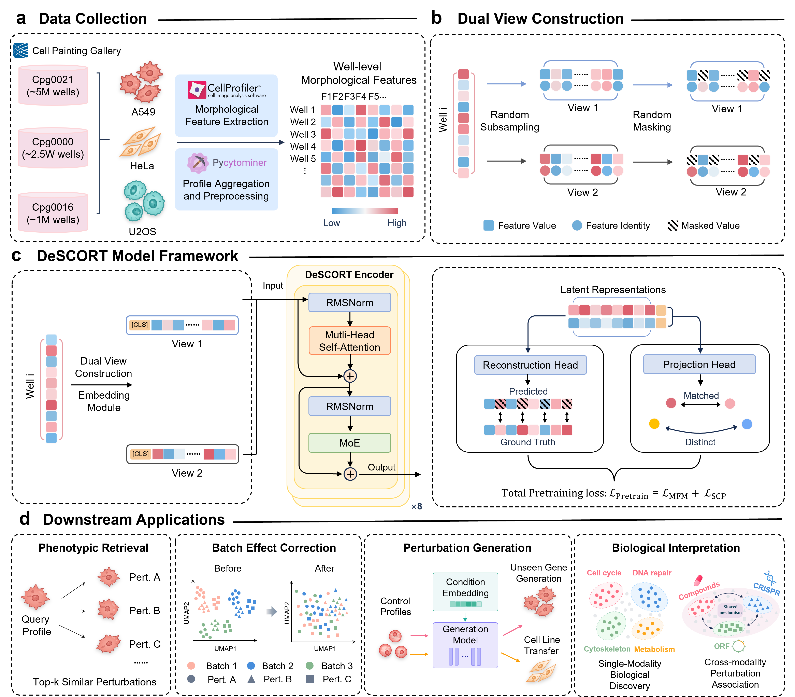

<p align="center">
  
</p>

# DeSCORT: Decoding Morphological Signatures of Cellular Responses to Perturbations



DeSCORT 是一个基于大规模 CRISPR 扰动数据构建的孔级（well-level）形态学基础模型。该模型采用 Transformer 架构联合编码形态学特征身份与连续数值，并结合掩码特征重构和扰动一致性对比学习，学习通用形态学表征。基于这一框架，DeSCORT 将开展扰动检索、批次校正、生物学功能关联、形态学特征生成及跨细胞系迁移研究，并进一步探索化学扰动、CRISPR 基因敲除与 ORF 过表达之间的功能联系，为形态学数据整合、虚拟扰动预测及作用机制解析提供新的方法学支持。

## Documentation

For installation instructions and step-by-step tutorials, see the [DeSCORT documentation](https://descort-script.readthedocs.io/en/latest/?refresh=no-reference-v2).

## 安装

### Step 1：创建 Python 环境

建议使用独立的 Conda 环境。以下以 Python 3.9 为例：

```bash
conda create -n DeSCORT python=3.9 pip -y
conda activate DeSCORT
python -m pip install --upgrade pip setuptools wheel
```

### Step 2：安装 PyTorch

根据机器的 NVIDIA 驱动支持情况选择 PyTorch 的 CUDA 构建。以下是 PyTorch **2.7.0** 的安装示例，**选择其中一种执行**；完整平台支持与命令见 [PyTorch 官方安装说明](https://pytorch.org/get-started/previous-versions/)。


```bash
# CUDA 11.8
python -m pip install torch==2.7.0 --index-url https://download.pytorch.org/whl/cu118
# CUDA 12.6
python -m pip install torch==2.7.0 --index-url https://download.pytorch.org/whl/cu126
# CUDA 12.8
python -m pip install torch==2.7.0 --index-url https://download.pytorch.org/whl/cu128
```

仅使用 CPU：

```bash
python -m pip install torch==2.7.0 --index-url https://download.pytorch.org/whl/cpu
```

安装后检查版本及 GPU 是否可用：

```bash
python -c "import torch; print('PyTorch:', torch.__version__); print('CUDA build:', torch.version.cuda); print('GPU available:', torch.cuda.is_available())"
```
CPU 版本的 `GPU available` 为 `False` 是正常的；GPU 训练环境需要能检测到可用 GPU。

### Step 3：安装 DeepSpeed

使用教程中以 `deepspeed` 启动的预训练或微调脚本时，需要先安装 DeepSpeed。以下使用本项目已使用的 **0.18.0** 版本：

```bash
python -m pip install deepspeed==0.18.0
```

### Step 4：安装 DeSCORT

#### 方式一：通过包索引安装（当前使用 TestPyPI）

目前 `descort==0.1.5` 已发布到 **TestPyPI 测试站**，尚未发布到正式 PyPI。先只从 TestPyPI 下载 DeSCORT 的 wheel，再从正式 PyPI 安装依赖。

```bash
python -m pip install \
  --index-url https://test.pypi.org/simple/ \
  --extra-index-url https://pypi.org/simple/ \
  descort==0.1.5
```

#### 方式二：从 GitHub 克隆并安装

先准备 Git，再克隆仓库并在仓库根目录安装：

```bash
git clone https://github.com/wyywyy999/DeSCORT_script.git
cd DeSCORT_script
python -m pip install .
```

源码 0.1.5 默认一起安装训练、预处理、虚拟细胞和下游分析依赖，无需填写依赖组。如果仓库为私有仓库，克隆时需要使用具有访问权限的 GitHub 账号完成 Git 认证。

### Step 5：检查安装

两种安装方式都可以使用同一组检查命令：

```bash
python -c "import descort; from descort import DeSCORTConfig, DeSCORTForContrastiveLM; print('DeSCORT:', descort.__version__); print('Package path:', descort.__file__)"
python -m pip show descort
```

需要确认 DeepSpeed 环境时，另行运行 `ds_report`。批次校正中的 R、scIB、DESC/TensorFlow 等后端按对应任务准备，见 [安装文档](docs/installation.md)。

`environments/environment.yml` 和 `environments/requirement.txt` 记录了原服务器的完整环境，其中包含额外工具及已知版本约束冲突，并不是上面两种安装方式的必经步骤；本节通过项目声明的依赖安装 DeSCORT。

## 加载已有模型

真实模型的基本用法：

```python
from descort import DeSCORTForContrastiveLM
model = DeSCORTForContrastiveLM.from_pretrained('/absolute/path/to/models')
model.eval()
# 输入字段与提取入口见 docs/data_format.md 和 docs/api/index.md。
```

## 任务导航

| 任务 | 入口 | 输入 → 输出 |
|---|---|---|
| Cell Painting 数据下载 | [00_download](tutorials/00_download/README.md) | Cell Painting Gallery（cpg0021、cpg0000、cpg0016）→ 原始特征文件 |
| 数据预处理与词表 | [01_preprocess_data](tutorials/01_preprocess_data/README.md) | CSV / Parquet → 聚合、归一化及裁剪数据、标签词表、特征交并集与筛选数据 |
| 预训练 | [02_pretrain](tutorials/02_pretrain/README.md) | parquet → Arrow dataset → 基础模型 |
| 表征微调与 embedding | [03_finetune](tutorials/03_finetune/README.md) | 基础模型、标注数据 → 表征模型与 embedding |
| mAP | [04_mAP](tutorials/04_mAP/README.md) | embedding → 检索指标 |
| 批次效应 | [05_batch_effect](tutorials/05_batch_effect/README.md) | AnnData → 校正结果和指标 |
| 虚拟细胞 | [06_virtual_cell](tutorials/06_virtual_cell/README.md) | 对照形态、扰动向量 → 扰动形态预测 |
| 生物学分析 | [07_biological](tutorials/07_biological/README.md) | 形态表征、注释 → 通路、聚类、富集分析 |
| 跨扰动类型 | [08_three_type](tutorials/08_three_type/README.md) | CRISPR / Compound / ORF → 共享表征分析 |
| 论文作图 | [09_paper_plot_code](tutorials/09_paper_plot_code/README.md) | 已有结果表 → 论文图 |

下载脚本在文件内配置路径后直接运行；预处理教程按五个步骤执行，其 Bash 脚本需在 `tutorials/01_preprocess_data` 目录下启动。其他任务的入口与参数见各自 README。详见 [教程总览](tutorials/README.md)。
