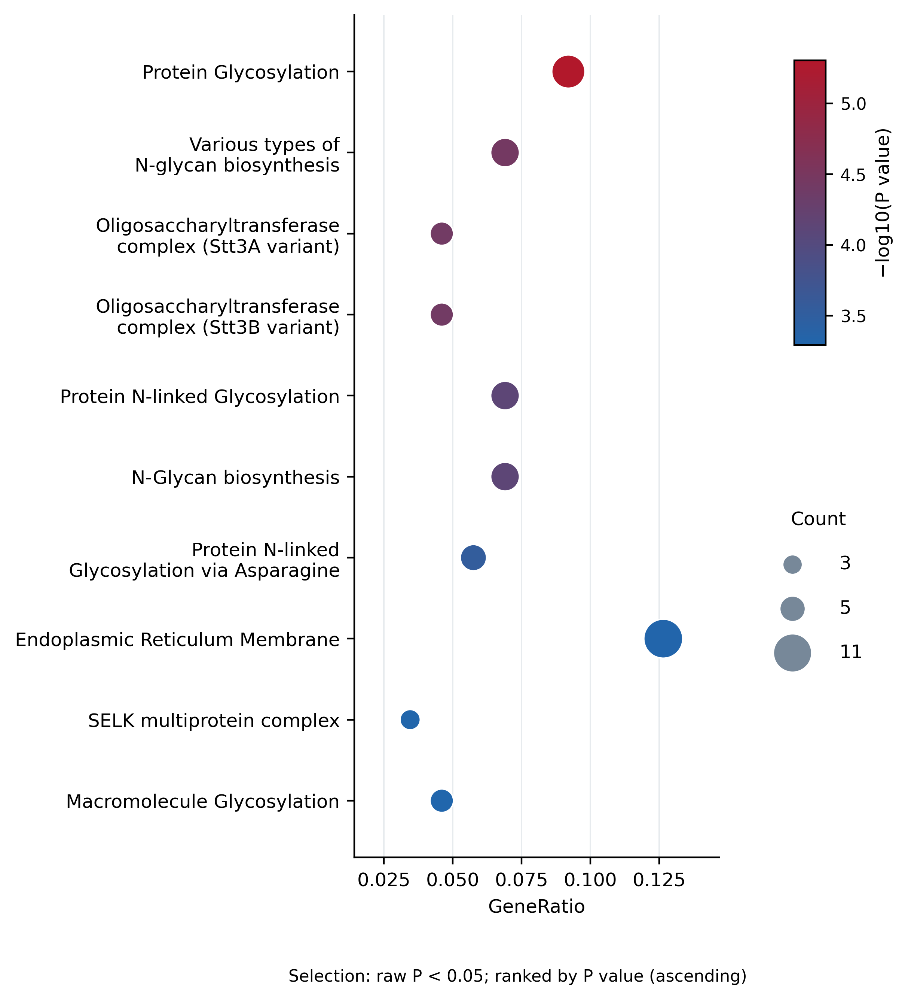

# 07 — Biological Interpretation of Morphological Representations

## Pipeline Overview

```text
           DeSCORT embedding + normalized morphology Parquet files
                                  │
                                  ▼
              ┌───────────────────────────────────────┐
              │           01_umap_analysis            │
              │ Aggregate gene profiles, PCA/UMAP     │
              │ Compare pathways and query neighbors  │
              └───────────────────┬───────────────────┘
                                  │
                                  ▼
              ┌───────────────────────────────────────┐
              │            02_CORUM_STRING            │
              │ Validate known complexes and          │
              │ interaction pairs in both spaces      │
              └───────────────────┬───────────────────┘
                                  │
                                  ▼
              ┌───────────────────────────────────────┐
              │             03_de_cluster             │
              │ Cluster gene representations          │
              │ Analyze morphology and enrichment     │
              └───────────────────┬───────────────────┘
                                  │
                                  ▼
              ┌───────────────────────────────────────┐
              │         04_cluster_enrichment         │
              │ Plot selected clusters using          │
              │ raw or adjusted enrichment P values   │
              └───────────────────┬───────────────────┘
                                  │
                                  ▼
                       Analysis tables and figures
```

Steps 1–3 analyze the profile inputs for different purposes; Step 2 does not consume Step 1's PCA coordinates. Step 4 reads the enrichment table produced by Step 3.

## Before You Start

Complete [data preprocessing](../01_preprocess_data/README.md), then extract DeSCORT embeddings with `04_run_emb.sh` in [pretraining](../02_pretrain/README.md) or `03_run_emb.sh` in [fine-tuning](../03_finetune/README.md). Set the biological analysis `--model-input` to the directory containing those embedding Parquet files and `--original-input` to the corresponding normalized morphology files.

This tutorial uses **cpg0021 A549 DMEM** as the example. Both inputs must preserve the gene and guide metadata needed for aggregation. It compares DeSCORT representations with original morphological features; it does not load a model or generate embeddings.

Activate the environment and enter this tutorial directory:

```bash
conda activate DeSCORT
cd /fse/home/wangyongyan/Project/CellPainting/DeSCORT/other_model/DeSCORT/tutorials/07_biological
bash 01_umap_analysis.sh --help
bash 02_CORUM_STRING.sh --help
bash 03_de_cluster.sh --help
bash 04_cluster_enrichment.sh --help
```

Follow the [installation instructions](../../docs/installation.md) for the base environment. Reading the Excel hit list additionally requires `openpyxl`. These analyses run on CPU; the Bash presets use 8 threads and a DuckDB memory limit of `24GB`, which is not a limit on total Python process memory.

Replace every `/absolute/path/...` placeholder below with your actual absolute path. The examples override the experiment-specific input and output presets explicitly. External datasets and annotation resources are not included in the Python package.

### Required inputs

| Input | A549 example requirements |
|---|---|
| DeSCORT embedding Parquet | `emb_0` through `emb_255` and gene/guide metadata |
| Normalized morphology Parquet | Matching plates and gene/guide metadata, with numerical morphology features |
| Gene column | `Metadata_Foci_Barcode_MatchedTo_GeneCode` |
| Guide column | `Metadata_Foci_Barcode_MatchedTo_Barcode` |
| Negative-control label | `nontargeting` |
| Hit list | `A549_DMEM_hits.xlsx`, with gene names in column `Gene` |
| Morphology feature list | `cpg0021_A549_union_feature_1382.pkl`; candidate feature names |
| Manual annotations | `annotated_gene_sets.json` |
| Full pathway JSON | Offline `database → pathway → gene list` mapping, such as a previous `gene_sets_used.json` |
| CORUM table | Tab-separated complex membership, including `subunits(Gene name)` |
| STRING table | CSV containing `protein1`, `protein2`, and `combined_score`, using matching gene symbols |

The example uses plates `CP186A CP186B CP186C CP186D CP186E CP186F CP186G CP186H CP186N`. Input directories must directly contain the selected Parquet files: these biological entries do not recursively search subdirectories. Passing `--plates` without values removes the plate-name filter.

Ensure the hit-list file exists. An empty or nonexistent hit file means using all available valid non-control genes, which changes the analysis cohort.

The preview images below come from existing A549 analyses, not a new run of these commands. Their source records are in the [image manifest](../../result/07_biological/A549_DMEM/manifest.json). Their cluster IDs and selected terms describe those historical results.

## Step 1 — Analyze Gene Profiles, Pathway UMAPs, and Neighbors

The workflow averages profiles within gene/guide groups, then takes the median across guides for each gene. It performs PCA separately for DeSCORT and original morphology, retaining 95% variance. Pathway compactness is measured using distances in PCA space; UMAP provides the two-dimensional visualization.

### Key arguments and presets

| Argument | Supplied Bash preset / meaning |
|---|---|
| `--model-input`, `--original-input` | Embedding and normalized morphology directories |
| `--output-dir` | Independent output directory for this step |
| `--hit-file`, `--hit-column` | Hit list and column `Gene` |
| `--original-features-pkl` | Candidate original morphology features |
| `--annotated-gene-sets` | Manual pathway annotations |
| `--gene-sets-json` | Offline full pathway mapping; otherwise libraries are fetched/cached through Enrichr |
| `--gene-column`, `--guide-column` | Metadata columns used for gene-level aggregation |
| `--plates` | The nine A549 plates listed above |
| `--model-feature-prefix`, `--model-feature-dim` | `emb_` and 256 |
| `--pca-variance` | 0.95 |
| `--umap-n-neighbors`, `--umap-min-dist`, `--umap-metric` | 10, 0.05, and `cosine` |
| `--distance-metric` | `cosine` for pathway distances |
| `--min-go-kegg-genes`, `--max-go-kegg-genes` | 5 and 200 selected genes per GO/KEGG pathway |
| `--min-annotated-genes` | 2 |
| `--query-gene`, `--query-top-n` | Bash enables `PSMA1 ATP6V0C`, with 20 neighbors |
| `--seed`, `--threads`, `--memory-limit` | 42, 8, and `24GB` |
| `--stage` | `all`, `model`, `original`, `compare`, `check`, `combined-plot`, or `query` |

### Example

```bash
bash 01_umap_analysis.sh \
  --model-input /absolute/path/embeddings/A549_DMEM \
  --original-input /absolute/path/normalized_profiles/A549_DMEM \
  --output-dir /absolute/path/biological/A549_DMEM/01_umap \
  --hit-file /absolute/path/annotations/A549_DMEM_hits.xlsx \
  --hit-column Gene \
  --original-features-pkl /absolute/path/selected_features/cpg0021_A549_union_feature_1382.pkl \
  --annotated-gene-sets /absolute/path/annotations/annotated_gene_sets.json \
  --gene-sets-json /absolute/path/annotations/gene_sets_used.json \
  --corum-file /absolute/path/annotations/CORUM_humanComplexes.txt \
  --string-file /absolute/path/annotations/STRING_data.csv \
  --dataset-name A549_DMEM \
  --plates CP186A CP186B CP186C CP186D CP186E CP186F CP186G CP186H CP186N \
  --pca-variance 0.95 \
  --query-gene PSMA1 ATP6V0C \
  --query-top-n 20 \
  --stage all
```

Use `--stage check` with the same paths before a full run. It inspects profile schemas and manual-annotation existence, but does not validate the complete offline pathway JSON. Use a fixed annotation snapshot when reproducing an experiment.

### Output

| File relative to `01_umap/` | Contents |
|---|---|
| `gene_sets_used.json` | Full pathway mapping used by the run |
| `model/results/hit_gene_profiles.parquet` | Selected valid DeSCORT gene profiles |
| `original/results/hit_gene_profiles.parquet` | Selected valid original morphology gene profiles |
| `model/results/global_hit_gene_UMAP.csv` | DeSCORT gene-level UMAP coordinates |
| `model/results/pathway_distance_df_model.csv` | DeSCORT pathway distances and members |
| `comparison/all_strict_pathways.csv` | Paired pathways with gene-set consistency information |
| `comparison/top_strict_pathways.csv` | Pathway subset selected for comparison |


For nearest-neighbor analysis only, rerun the example with `--stage query`. To redraw saved combined pathway UMAPs after a completed run, use `--stage combined-plot` and the same output directory. The Python entry skips neighbor analysis if no query gene is supplied, whereas the Bash preset already supplies two genes.

## Step 2 — Validate CORUM Complexes and STRING Interactions

This step selects valid hit genes common to both representations, fits PCA separately, L2-normalizes gene vectors, and calculates cosine similarities with a nonedge-background correction. Its intermediate representation is specific to this analysis.

### Key arguments and presets

| Argument | Supplied Bash preset / meaning |
|---|---|
| `--model-input`, `--original-input`, `--hit-file` | Same experiment inputs and hit list as Step 1 |
| `--original-features-pkl` | Candidate morphology features |
| `--corum-file`, `--string-file` | Complex-membership and interaction tables |
| `--output-dir` | CORUM/STRING output directory |
| `--pca-variance` | 0.95 |
| `--corum-min-coverage` | 0.333; coverage criterion for CORUM complexes |
| `--string-low-score`, `--string-high-score` | 300 and 700; score thresholds used by the analysis |
| `--string-chunk-size`, `--pair-chunk-size` | 500000 and 50000 |
| `--seed`, `--threads`, `--memory-limit` | 20260918, 8, and `24GB` |
| `--stage` | Includes `all`, `check`, `corum-plot`, and `string-plot` |

### Example

```bash
bash 02_CORUM_STRING.sh \
  --model-input /absolute/path/embeddings/A549_DMEM \
  --original-input /absolute/path/normalized_profiles/A549_DMEM \
  --output-dir /absolute/path/biological/A549_DMEM/02_CORUM_STRING \
  --hit-file /absolute/path/annotations/A549_DMEM_hits.xlsx \
  --original-features-pkl /absolute/path/selected_features/cpg0021_A549_union_feature_1382.pkl \
  --corum-file /absolute/path/annotations/CORUM_humanComplexes.txt \
  --string-file /absolute/path/annotations/STRING_data.csv \
  --dataset-name A549_DMEM \
  --plates CP186A CP186B CP186C CP186D CP186E CP186F CP186G CP186H CP186N \
  --pca-variance 0.95 \
  --corum-min-coverage 0.333 \
  --string-low-score 300 \
  --string-high-score 700 \
  --stage all
```

Use `--stage check` with these paths before calculation. Use `--stage corum-plot` or `--stage string-plot` to redraw figures from existing result tables in the same output directory.

### Output

| File relative to `02_CORUM_STRING/` | Contents |
|---|---|
| `results/common_selected_genes.csv` | Genes used in both representations |
| `results/input_qc.json` | Input and processing records |
| `results/CORUM_background_corrected.csv` | Background-corrected CORUM similarities |
| `results/STRING_background_corrected.csv` | Background-corrected STRING similarities |
| `results/metrics.csv` | Evaluation metrics |
| `results/paired_change_summary.csv` | Summary of paired representation comparisons |
| `figures/CORUM_background_corrected_distribution.png` | CORUM similarity distribution |
| `figures/STRING_similarity_quantiles_line.png` | STRING similarity-bin curves |


## Step 3 — Cluster Representations and Analyze Differential Morphology

Clustering uses DeSCORT PCA representations without pathway labels as inputs. Original morphology explains feature differences between those clusters. The workflow also computes biological-pair support, pathway/complex enrichment, and nearest-neighbor tables, with an original-feature clustering comparison.

### Prepare a pathway membership snapshot

The cluster workflow needs a CSV containing `database`, `pathway`, and `genes`. To use the same full annotations as Step 1, convert that run's `gene_sets_used.json`:

```python
from pathlib import Path
import json
import pandas as pd

source = Path("/absolute/path/biological/A549_DMEM/01_umap/gene_sets_used.json")
output = Path("/absolute/path/biological/A549_DMEM/annotations/pathway_membership.csv")
sets = json.loads(source.read_text())
rows = []
for database, pathways in sets.items():
    for pathway, genes in pathways.items():
        members = list(dict.fromkeys(str(g).strip() for g in genes
                                    if g is not None and str(g).strip()))
        if members:
            rows.append({"database": database, "pathway": pathway,
                         "genes": ";".join(members)})
output.parent.mkdir(parents=True, exist_ok=True)
pd.DataFrame(rows, columns=["database", "pathway", "genes"]).to_csv(output, index=False)
print(output)
```

This creates membership annotations, not pathway distances. The cluster workflow ignores distance/rank columns if present. To reproduce a historical experiment exactly, supply its original snapshot; a newly generated annotation scope can differ.

### Key arguments and presets

| Argument | Supplied Bash preset / meaning |
|---|---|
| `--model-input`, `--original-input`, `--hit-file` | Matched representation inputs and hit list |
| `--pathway-snapshot` | Membership CSV prepared above; specify explicitly for this run |
| `--selected-pathways-json` | List of `[database, pathway]` pairs; supplied JSON must remain available |
| `--corum-file`, `--string-file` | Biological relation resources |
| `--output-dir` | Cluster-analysis output directory |
| `--n-clusters` | 10; override for another experiment |
| `--stability-seeds`, `--kmeans-n-init` | 5 and 20 |
| `--de-fdr` | 0.05 |
| `--min-cohens-d`, `--min-mean-difference` | 0.5 and 0.2 |
| `--pair-permutations`, `--cluster-permutations` | 200 and 200 |
| `--case-random-repeats`, `--pathway-random-repeats` | 10000 and 10000 |
| `--seed`, `--umap-seed` | 20260926 and 42 |
| `--stage` | `all`, `check`, `plot`, or `query` |

### Example

```bash
bash 03_de_cluster.sh \
  --model-input /absolute/path/embeddings/A549_DMEM \
  --original-input /absolute/path/normalized_profiles/A549_DMEM \
  --output-dir /absolute/path/biological/A549_DMEM/03_de_cluster \
  --hit-file /absolute/path/annotations/A549_DMEM_hits.xlsx \
  --original-features-pkl /absolute/path/selected_features/cpg0021_A549_union_feature_1382.pkl \
  --corum-file /absolute/path/annotations/CORUM_humanComplexes.txt \
  --string-file /absolute/path/annotations/STRING_data.csv \
  --pathway-snapshot /absolute/path/biological/A549_DMEM/annotations/pathway_membership.csv \
  --selected-pathways-json /fse/home/wangyongyan/Project/CellPainting/DeSCORT/other_model/DeSCORT/tutorials/07_biological/03_de_cluster_selected_pathways.json \
  --dataset-name A549_DMEM \
  --plates CP186A CP186B CP186C CP186D CP186E CP186F CP186G CP186H CP186N \
  --n-clusters 10 \
  --de-fdr 0.05 \
  --min-cohens-d 0.5 \
  --min-mean-difference 0.2 \
  --stage all
```

Use `--stage check` first. After a completed run, `--stage plot` redraws cached figures, while `--stage query --query-gene PSMA1 ATP6V0C` exports query tables from the saved neighbor table. Cluster IDs depend on the data and settings; do not transfer their biological interpretation between runs without checking membership.

### Output

| File relative to `03_de_cluster/` | Contents |
|---|---|
| `results/gene_cluster_assignment.csv` | Gene assignments for DeSCORT and original-feature clustering |
| `results/cluster_differential_features.csv` | Differential morphology features for DeSCORT clusters |
| `results/cluster_pathway_complex_enrichment.csv` | Enrichment table used by Step 4 |
| `results/cluster_top_biological_terms.csv` | Leading biological terms per cluster/database |
| `results/biological_pair_support.csv` | Biological-pair support results |
| `results/analysis_summary.json` | Analysis summary |
| `figures/figure1_unsupervised_clusters.png` | Cluster UMAP |
| `figures/figure3_differential_feature_heatmap_clustered.png` | Differential morphology heatmap |


## Step 4 — Plot Enrichment for Selected Clusters

This step reads Step 3's enrichment table. It does not rerun clustering or recalculate BH correction. The Bash preset selects clusters `2 3 4`; verify that these IDs exist in your own DeSCORT results.

### Key arguments

| Argument | Meaning |
|---|---|
| `--enrichment-file` | `cluster_pathway_complex_enrichment.csv` from Step 3 |
| `--output-dir` | Root directory for enrichment figures and selected tables |
| `--cluster` | One or more DeSCORT cluster IDs |
| `--top-n` | Maximum plotted terms per cluster; preset 10 |
| `--fdr` | Threshold for existing database-wise BH-adjusted values; preset 0.05 |
| `--p-value-mode` | `raw` by default, or `adjusted` |
| `--figure-formats`, `--png-dpi` | Presets `pdf svg png` and 400 |

### Choose the plotting mode

| Mode | Plot selection and ranking | Bubble color | Output subdirectories |
|---|---|---|---|
| `raw` | Raw `p_value < 0.05`, ascending raw P | `−log10(p_value)` | `results/`, `figures/`, `qa/` |
| `adjusted` | Existing `p_adj_BH_within_database < --fdr`, ascending adjusted P | `−log10(p.adjust)` | `results_p.adjust/`, `figures_p.adjust/`, `qa_p.adjust/` |

In both modes, the exported `cluster*_DeSCORT_enrichment_significant.csv` uses the existing BH-adjusted values and `--fdr`. Thus, in raw mode, plotted terms and BH-significant exported terms need not be the same. `GeneRatio = overlap_n / cluster_size`, and bubble area represents `Count = overlap_n`.

### Example

Plot raw-P-ranked enrichment:

```bash
bash 04_cluster_enrichment.sh \
  --enrichment-file /absolute/path/biological/A549_DMEM/03_de_cluster/results/cluster_pathway_complex_enrichment.csv \
  --output-dir /absolute/path/biological/A549_DMEM/04_cluster_enrichment \
  --cluster 2 3 4 \
  --top-n 10 \
  --fdr 0.05 \
  --p-value-mode raw \
  --figure-formats pdf svg png \
  --png-dpi 400
```

Run the same command with `--p-value-mode adjusted` for adjusted-P filtering, ranking, and coloring. The directory suffix keeps both modes' results separate. If a cluster has no eligible terms, raw mode skips its bubble plot; adjusted mode exports a figure stating that no significant enrichment was found.

### Output

For raw mode, paths relative to `04_cluster_enrichment/` include:

| File | Contents |
|---|---|
| `results/cluster3_DeSCORT_enrichment_significant.csv` | BH-significant terms for cluster 3 |
| `results/cluster3_analysis_summary.json` | Selection counts, plotting mode, and ranking details |
| `results/analysis_summary.json` | Summary for all requested clusters |
| `figures/figure_cluster3_enrichment_bubble.png` | Cluster 3 bubble plot |
| `figures/figure_cluster3_enrichment_bubble_data.csv` | Eligible terms; `plotted` marks displayed terms |

Adjusted mode uses the corresponding `_p.adjust` directories and suffixed parameter/log filenames.



## Complete Output Directory and File Contents

The existing A549 DMEM results use this final layout:

```text
result/
├── 01_umap_analysis/cpg0021_A549_DMEM/
│   ├── model/{results,figures}/
│   ├── original/{results,figures}/
│   ├── comparison/
│   ├── library_cache/
│   └── gene_sets_used.json
├── 02_CORUM_STRING/cpg0021_A549_DMEM/
│   ├── results/{model,original}/
│   ├── figures/
│   └── qa/
├── 03_de_cluster/hit_10_cluster/
│   ├── results/profiles/{model,original}/
│   ├── figures/
│   └── qa/
└── 04_cluster_enrichment/
    ├── results/, figures/, qa/
    └── results_p.adjust/, figures_p.adjust/, qa_p.adjust/
```

See the [complete output file guide](OUTPUT_FILES.md) for each saved table, matrix, annotation file, figure family, log, and QA record, including the correspondence between these historical folders and the output paths in this tutorial. The guide inventories the existing A549 run; external figure-review records and stage-specific redraw files are not all produced by a single `all` run.
