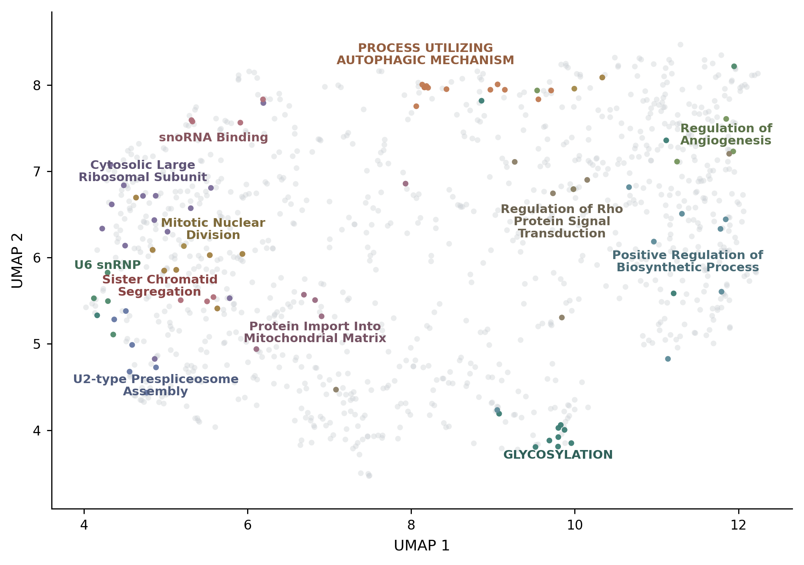
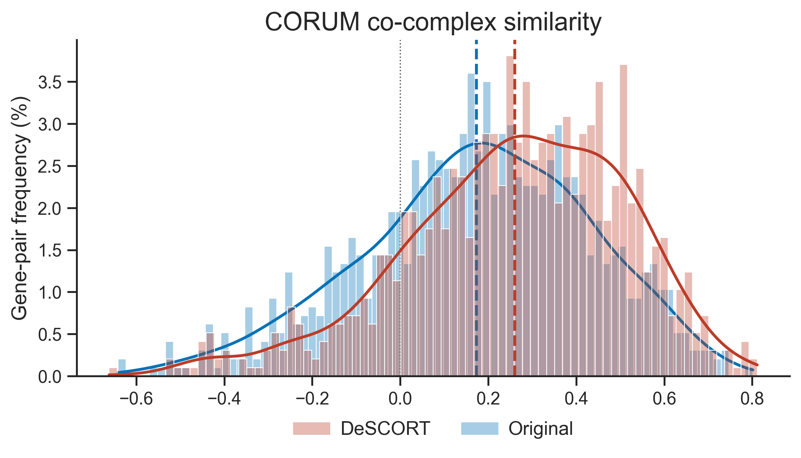
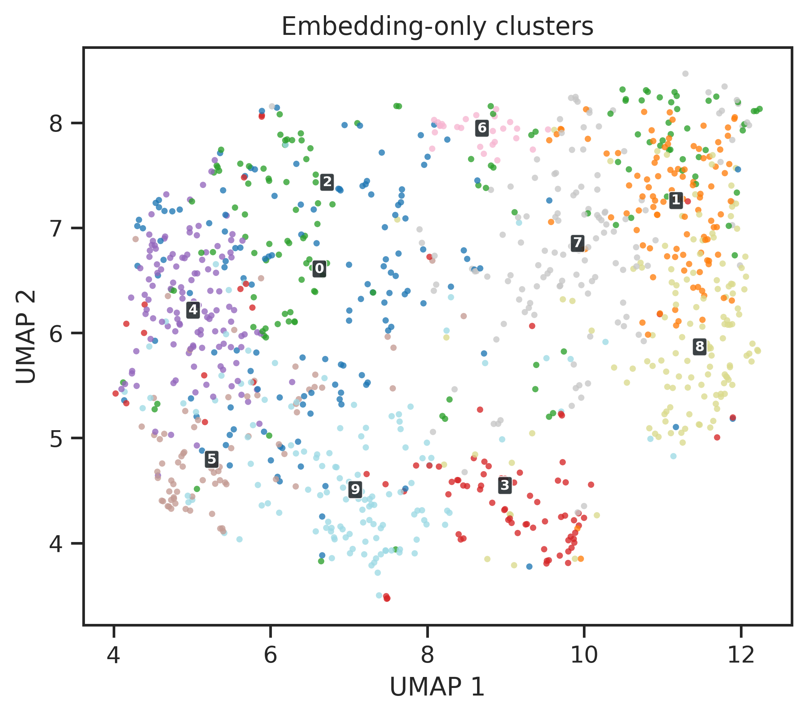

# A549 DMEM：从形态表征到生物学解释

本教程以 **cpg0021 A549 DMEM** 为例，演示如何比较 DeSCORT 表征与原始形态特征，并完成通路可视化、CORUM/STRING 验证、无监督聚类、差异形态特征分析和富集绘图。教程按照“数据准备 → 分步命令 → 输出说明 → 结果预览”组织。

这里从已经完成预处理和 embedding 提取的 parquet 开始。若尚未生成输入，请先完成 [预处理](../01_preprocess_data/README.md) 和 [表征提取](../03_finetune/README.md)。本例使用当前目录中的 A549 Bash 脚本；HeLa 的专用脚本不在本例范围内。

| 步骤 | 入口 | 主要用途 |
|---|---|---|
| 1 | [01_umap_analysis.sh](01_umap_analysis.sh) | 基因表征聚合、PCA/UMAP、通路距离和近邻示例 |
| 2 | [02_CORUM_STRING.sh](02_CORUM_STRING.sh) | 比较已知复合体与相互作用基因对的相似性 |
| 3 | [03_de_cluster.sh](03_de_cluster.sh) | 表征聚类、差异形态特征、通路/复合体富集 |
| 4 | [04_cluster_enrichment.sh](04_cluster_enrichment.sh) | 从步骤 3 的富集表绘制指定簇的气泡图 |

> 文中的预览图复制自已有的 A549 分析结果，用于说明输出形式，并非本次编写文档时重新运行得到。图像来源及校验值见 [图片来源清单](../../result/07_biological/A549_DMEM/manifest.json)。重新运行时，结果还取决于输入数据、注释版本和软件环境。

## Step 0　准备环境与 A549 输入

### 0.1 安装环境

在整理后的仓库根目录运行：

```bash
cd /fse/home/wangyongyan/Project/CellPainting/DeSCORT/other_model/DeSCORT

# 若使用本机已有环境，先执行：conda activate DeSCORT
python -m pip install -e '.[analysis]'
python -m pip install openpyxl
```

`openpyxl` 用于读取本例的 Excel hit 表。后续分析使用 CPU；A549 脚本默认设置 8 个线程，DuckDB 内存上限为 `24GB`。该内存参数不是整个 Python 进程的总内存上限。

### 0.2 输入文件与格式

| 输入 | 本例要求 |
|---|---|
| DeSCORT embedding | 9 个 plate 的 parquet，包含 `emb_0` 到 `emb_255` |
| 原始形态特征 | 相同 plate 的归一化 parquet；按所选特征表读取数值列 |
| 基因与 guide 元数据 | 两类 parquet 均含 `Metadata_Foci_Barcode_MatchedTo_GeneCode` 和 `Metadata_Foci_Barcode_MatchedTo_Barcode` |
| Hit 表 | `A549_DMEM_hits.xlsx`，基因名称列为 `Gene` |
| 所选形态特征 | `cpg0021_A549_union_feature_1382.pkl`，候选特征名称列表 |
| 手工通路注释 | `annotated_gene_sets.json` |
| GO/KEGG 基因集 | 本例使用已有 `gene_sets_used.json`，固定离线注释版本 |
| CORUM | 制表符分隔表；默认成员列为 `subunits(Gene name)`，名称需与基因符号一致 |
| STRING | CSV，包含 `protein1`、`protein2`、`combined_score`；前两列需使用与输入一致的基因名称 |

本例选择 `CP186A CP186B CP186C CP186D CP186E CP186F CP186G CP186H CP186N`，对照标签为 `nontargeting`。输入目录应直接包含这些 plate 的 parquet；当前生物学入口不会递归查找子目录。

### 0.3 统一配置输入和新输出目录

下面是当前服务器上的实际路径。若在其他机器运行，请将这些路径替换为自己的数据位置。数据、注释和权重没有随 GitHub 仓库一起发布。

在**同一个 Bash 会话**中依次执行本文命令，使后续步骤沿用这组环境变量：

```bash
export REPO_ROOT="$PWD"
export CP_WORKSPACE="/fse/home/wangyongyan/Project/CellPainting"
export ORIGINAL_PROJECT="$CP_WORKSPACE/DeSCORT"
export TUTORIAL_DIR="$REPO_ROOT/tutorials/07_biological"
export PYTHON_BIN="python"

export MODEL_INPUT="$CP_WORKSPACE/Paper_LLm/tutorials/01_mAP/well_level_new_site_pretrain_emb_attention_mask/cpg0021_A549_DeSCORT_1382_nosampling_layernorm_finetune_A549/20200805_A549_WG_Screen/normalization_clip_data"
export ORIGINAL_INPUT="/fse/DC/CP_data/feature_data/20200805_A549_WG_Screen/raw_data/well_level_new/normalization_clip_data"
export HIT_FILE="$ORIGINAL_PROJECT/common_files/biological/A549_DMEM_hits.xlsx"
export ORIGINAL_FEATURES_PKL="$ORIGINAL_PROJECT/common_files/feature_intersection_union/cpg0021_A549/cpg0021_A549_union_feature_1382.pkl"
export ANNOTATED_GENE_SETS="$CP_WORKSPACE/LLLM/annotated_gene_sets.json"
export CORUM_FILE="$CP_WORKSPACE/LLLM/common_files/CORUM_humanComplexes.txt"
export STRING_FILE="$CP_WORKSPACE/LLLM/common_files/STRING_data.csv"

# 已有 A549 运行保存的完整基因集；用于离线执行步骤 1。
export GENE_SETS_JSON="$ORIGINAL_PROJECT/tutorials/07_biological_new/result/01_umap_analysis/cpg0021_A549_DMEM/gene_sets_used.json"

# 本例的所有新结果集中写入这里。
export EXAMPLE_OUTPUT="$REPO_ROOT/outputs/07_biological/A549_DMEM"
mkdir -p "$EXAMPLE_OUTPUT"
```

检查路径和 plate 文件是否齐全：

```bash
"$PYTHON_BIN" - <<'PY'
import os
from pathlib import Path

plates = ['CP186A', 'CP186B', 'CP186C', 'CP186D', 'CP186E',
          'CP186F', 'CP186G', 'CP186H', 'CP186N']
for name in ['MODEL_INPUT', 'ORIGINAL_INPUT']:
    folder = Path(os.environ[name])
    files = sorted(folder.glob('*.parquet'))
    for plate in plates:
        matched = [p for p in files if plate in p.name]
        if len(matched) != 1:
            raise ValueError(f'{name}: {plate} 应对应 1 个文件，实际找到 {len(matched)} 个')
    print(f'{name}: 9 个 plate 文件已找到')

for name in ['HIT_FILE', 'ORIGINAL_FEATURES_PKL', 'ANNOTATED_GENE_SETS',
             'CORUM_FILE', 'STRING_FILE', 'GENE_SETS_JSON']:
    path = Path(os.environ[name])
    if not path.is_file():
        raise FileNotFoundError(f'{name}: {path}')
    print(f'{name}: OK')
PY
```

本例要求 hit 表实际存在。底层脚本在 hit 文件为空或不存在时会改用所有可用的非对照基因；不要把这种运行误认为相同的 A549 hit 分析。

## Step 1　基因表征、通路 UMAP 与近邻分析

### 1.1 检查输入

```bash
OUTPUT_DIR="$EXAMPLE_OUTPUT/01_umap" \
bash "$TUTORIAL_DIR/01_umap_analysis.sh" --stage check
```

检查包括 parquet 中的基因/guide 元数据、数值特征列及手工通路注释文件。`--stage check` 不计算 PCA/UMAP；它也不验证完整 GO/KEGG 基因集内容。

### 1.2 运行 A549 分析

```bash
OUTPUT_DIR="$EXAMPLE_OUTPUT/01_umap" \
bash "$TUTORIAL_DIR/01_umap_analysis.sh" \
    --stage all \
    --gene-sets-json "$GENE_SETS_JSON" \
    --query-gene PSMA1 ATP6V0C \
    --query-top-n 20
```

脚本先按基因和 guide 对各行取均值，再在同一基因的 guide 之间取中位数，并移除无效数据；随后在 DeSCORT 与原始形态空间分别进行保留 95% 方差的 PCA，再计算 UMAP。通路内距离使用 PCA 表征上的余弦距离；UMAP 坐标用于二维展示。

本例沿用 A549 Bash 参数：UMAP `n_neighbors=10`、`min_dist=0.05`、`metric=cosine`、随机种子 `42`。GO/KEGG 使用 5–200 个入选基因的通路；手工注释通路至少含 2 个入选基因。通路比较采用脚本的基因集合一致性检查，具体记录在比较结果表中。

当前 A549 `.sh` 已经启用 `PSMA1` 和 `ATP6V0C` 查询，上述命令将它们显式写出。Python 入口自身在未指定查询基因时跳过 figure 7；这与 A549 Bash 的预设不同。

主要输出相对于 `$EXAMPLE_OUTPUT/01_umap`：

| 文件 | 含义 |
|---|---|
| `gene_sets_used.json` | 本次实际使用的完整基因集，供步骤 3 生成注释快照 |
| `model/results/hit_gene_profiles.parquet` | DeSCORT 的有效入选基因表征 |
| `original/results/hit_gene_profiles.parquet` | 原始形态的有效入选基因表征 |
| `model/results/global_hit_gene_UMAP.csv` | DeSCORT 基因 UMAP 坐标 |
| `model/results/pathway_distance_df_model.csv` | DeSCORT 通路内距离及基因成员 |
| `comparison/all_strict_pathways.csv` | 满足比较条件的通路配对结果 |
| `comparison/top_strict_pathways.csv` | 按当前参数选择的通路比较子集 |

预览：已有 A549 DeSCORT 表征中的通路叠加图。每个点代表一个入选基因，颜色标记展示的通路成员。



### 1.3 单独运行查询或重绘

只运行近邻示例时，仍使用同一组输入：

```bash
OUTPUT_DIR="$EXAMPLE_OUTPUT/01_umap" \
bash "$TUTORIAL_DIR/01_umap_analysis.sh" \
    --stage query --gene-sets-json "$GENE_SETS_JSON" \
    --query-gene PSMA1 ATP6V0C --query-top-n 20
```

`query` 会从当前输入/基因表征重新组织近邻计算，不要求先运行聚类脚本。若只想重绘已保存的通路组合 UMAP，在完成 1.2 后使用：

```bash
OUTPUT_DIR="$EXAMPLE_OUTPUT/01_umap" \
bash "$TUTORIAL_DIR/01_umap_analysis.sh" --stage combined-plot
```

## Step 2　CORUM/STRING 生物学关系验证

这一阶段先选取两种表征共同包含的有效 hit 基因，再分别拟合 PCA、执行行向量 L2 归一化，并计算基因对的余弦相似性与非关联背景校正。它与步骤 1、步骤 3 的处理顺序各有用途，不能直接混用其中间表示。

```bash
# 先检查输入及 CORUM/STRING 文件。
OUTPUT_DIR="$EXAMPLE_OUTPUT/02_CORUM_STRING" \
bash "$TUTORIAL_DIR/02_CORUM_STRING.sh" --stage check

# 使用同一组 A549 输入、hit 表和特征集合进行计算。
OUTPUT_DIR="$EXAMPLE_OUTPUT/02_CORUM_STRING" \
bash "$TUTORIAL_DIR/02_CORUM_STRING.sh" --stage all
```

本例沿用 A549 设置：PCA 保留 95% 方差，CORUM 成员覆盖率参数为 `0.333`，STRING 低/高分阈值参数为 `300` / `700`，随机种子为 `20260918`。具体阈值的边界判断以实现为准。

主要输出相对于 `$EXAMPLE_OUTPUT/02_CORUM_STRING`：

| 文件 | 含义 |
|---|---|
| `results/common_selected_genes.csv` | 两种表征共同使用的有效基因 |
| `results/input_qc.json` | 输入、基因筛选及处理顺序记录 |
| `results/CORUM_background_corrected.csv` | CORUM 基因对的背景校正相似性 |
| `results/STRING_background_corrected.csv` | STRING 基因对的背景校正相似性 |
| `results/metrics.csv` | 计算得到的评价指标 |
| `results/paired_change_summary.csv` | 基因对配对比较摘要 |
| `figures/CORUM_background_corrected_distribution.png` | CORUM 相似性分布图 |
| `figures/STRING_similarity_quantiles_line.png` | STRING 相似性分段曲线图 |

预览：已有 A549 结果中，DeSCORT 与原始形态特征的 CORUM 背景校正相似性分布。



若只需从本次已保存的基因对表重新绘图：

```bash
OUTPUT_DIR="$EXAMPLE_OUTPUT/02_CORUM_STRING" \
bash "$TUTORIAL_DIR/02_CORUM_STRING.sh" --stage corum-plot

OUTPUT_DIR="$EXAMPLE_OUTPUT/02_CORUM_STRING" \
bash "$TUTORIAL_DIR/02_CORUM_STRING.sh" --stage string-plot
```

## Step 3　表征聚类、差异形态与通路富集

### 3.1 从本次基因集生成聚类所需的注释快照

`03_de_cluster.sh` 的历史默认 `PATHWAY_SNAPSHOT` 指向另一个旧结果目录。本例将步骤 1 保存的**完整基因集**转换为三列 CSV，然后显式传给聚类脚本，使本次流程使用同一套通路注释。

```bash
export PATHWAY_SNAPSHOT="$EXAMPLE_OUTPUT/annotations/pathway_membership.csv"

"$PYTHON_BIN" - <<'PY'
import json
import os
from pathlib import Path
import pandas as pd

source = Path(os.environ['EXAMPLE_OUTPUT']) / '01_umap/gene_sets_used.json'
sets = json.loads(source.read_text())
rows = []
for database, pathways in sets.items():
    for pathway, genes in pathways.items():
        members = list(dict.fromkeys(str(g).strip() for g in genes
                                    if g is not None and str(g).strip()))
        if members:
            rows.append({'database': database, 'pathway': pathway,
                         'genes': ';'.join(members)})
snapshot = Path(os.environ['PATHWAY_SNAPSHOT'])
snapshot.parent.mkdir(parents=True, exist_ok=True)
pd.DataFrame(rows, columns=['database', 'pathway', 'genes']).to_csv(snapshot, index=False)
print(f'已保存 {len(rows)} 个通路/基因集：{snapshot}')
PY
```

这里生成的是成员注释表，没有生成或伪造通路距离。聚类入口只要求 `database`、`pathway`、`genes` 三列，忽略快照中的距离和排名列。若要严格复用某次历史实验的注释范围，应将 `PATHWAY_SNAPSHOT` 改为该次实验的原始快照；不要把两者视为必然数值相同。

### 3.2 检查并运行 10 簇 A549 示例

```bash
OUTPUT_DIR="$EXAMPLE_OUTPUT/03_de_cluster" \
bash "$TUTORIAL_DIR/03_de_cluster.sh" --stage check

OUTPUT_DIR="$EXAMPLE_OUTPUT/03_de_cluster" \
bash "$TUTORIAL_DIR/03_de_cluster.sh" --stage all --n-clusters 10
```

该脚本在 DeSCORT 的 PCA 表征上进行无监督 KMeans 聚类，再用原始形态特征解释各簇的差异，并计算通路/复合体富集和生物学关系支持。聚类不使用通路标签作为输入；二维 UMAP 用于展示聚类结果。

本例沿用 A549 参数：`n_clusters=10`、`stability_seeds=5`、`kmeans_n_init=20`、随机种子 `20260926`，差异形态特征筛选阈值为 `de_fdr=0.05`、`min_cohens_d=0.5`、`min_mean_difference=0.2`。具体效应量和检验口径以结果表及源码为准。

主要输出相对于 `$EXAMPLE_OUTPUT/03_de_cluster`：

| 文件 | 含义 |
|---|---|
| `results/gene_cluster_assignment.csv` | 基因与 DeSCORT/Original 簇的对应关系 |
| `results/cluster_differential_features.csv` | 按 DeSCORT 簇计算的原始形态特征差异 |
| `results/cluster_pathway_complex_enrichment.csv` | 两种表征的通路/复合体富集结果，步骤 4 的输入 |
| `results/cluster_top_biological_terms.csv` | 各簇、各数据库排名靠前的条目 |
| `results/biological_pair_support.csv` | 生物学基因对支持结果 |
| `results/analysis_summary.json` | 本次分析摘要 |
| `figures/figure1_unsupervised_clusters.png` | DeSCORT 聚类的 UMAP 展示 |
| `figures/figure3_differential_feature_heatmap_clustered.png` | 差异形态特征热图 |

预览：已有 A549 10 簇结果。编号对应该次运行的簇，不能据此预设不同数据或参数下的簇编号含义。



## Step 4　指定簇的富集气泡图

本例与当前 A549 Bash 预设一致，选择簇 `2 3 4`，每簇最多展示 10 个条目。首先确认这些编号存在于本次结果：

```bash
export ENRICHMENT_FILE="$EXAMPLE_OUTPUT/03_de_cluster/results/cluster_pathway_complex_enrichment.csv"

"$PYTHON_BIN" - <<'PY'
import os
import pandas as pd

table = pd.read_csv(os.environ['ENRICHMENT_FILE'])
ids = sorted(table.loc[table.representation == 'DeSCORT', 'cluster'].unique())
print('本次 DeSCORT 可用簇编号：', ids)
PY
```

然后运行绘图：

```bash
OUTPUT_DIR="$EXAMPLE_OUTPUT/04_cluster_enrichment" \
CLUSTER="2 3 4" \
bash "$TUTORIAL_DIR/04_cluster_enrichment.sh" --top-n 10 --fdr 0.05
```

当前实现有两种不同的筛选口径：

- `results/cluster*_DeSCORT_enrichment_significant.csv` 使用输入表中已有的、按数据库校正的 BH 值 `p_adj_BH_within_database < 0.05`。
- 气泡图先筛选 **原始 `p_value < 0.05`**，按原始 P 值从小到大排序，最多绘制 10 项。横轴为 `GeneRatio = overlap_n / cluster_size`，点面积表示 `Count = overlap_n`，颜色表示 `−log10(原始 P 值)`。因此图中的条目不保证全部通过 BH 校正后的 0.05 阈值。

本阶段读取步骤 3 的结果，不重新聚类或重新计算 FDR。若某簇没有原始 P 值通过筛选的条目，程序跳过该簇气泡图。

主要输出相对于 `$EXAMPLE_OUTPUT/04_cluster_enrichment`：

| 文件 | 含义 |
|---|---|
| `results/cluster3_DeSCORT_enrichment_significant.csv` | 簇 3 的 BH 显著条目 |
| `results/cluster3_analysis_summary.json` | 簇 3 的筛选与展示计数 |
| `figures/figure_cluster3_enrichment_bubble.png` | 簇 3 的富集气泡图 |
| `figures/figure_cluster3_enrichment_bubble_data.csv` | 原始 P 值通过筛选的候选条目，`plotted` 标识最终展示项 |

预览：已有 A549 簇 3 的富集气泡图。该图的簇编号和条目属于图片来源中的历史运行。


## Step 5　读取结果与记录复现信息

在完成步骤 1–4 后，可汇总查看结果：

```bash
"$PYTHON_BIN" - <<'PY'
import json
import os
from pathlib import Path
import pandas as pd

root = Path(os.environ['EXAMPLE_OUTPUT'])
print('CORUM/STRING 指标：')
print(pd.read_csv(root / '02_CORUM_STRING/results/metrics.csv').to_string(index=False))
print('\n各 DeSCORT 簇的基因数：')
assignment = pd.read_csv(root / '03_de_cluster/results/gene_cluster_assignment.csv')
print(assignment.groupby('embedding_cluster').size().to_string())
print('\n富集绘图摘要：')
summary = json.loads((root / '04_cluster_enrichment/results/analysis_summary.json').read_text())
print(json.dumps(summary, ensure_ascii=False, indent=2))
PY
```

保留各步骤的 `*_parameters.json`、输入检查记录、`gene_sets_used.json`、生成的 `pathway_membership.csv` 和软件环境版本。通路 UMAP、CORUM/STRING、聚类分别记录自己的有效基因与处理过程；比较前应检查对应的 QC 表，不假定所有步骤最终使用完全相同的基因数。

更多格式与环境说明见 [输入格式](../../docs/data_format.md)、[安装说明](../../docs/installation.md) 和 [复现约定](../../docs/reproducibility.md)。
